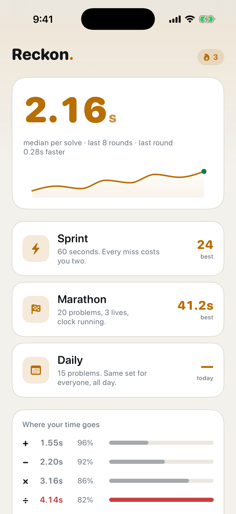
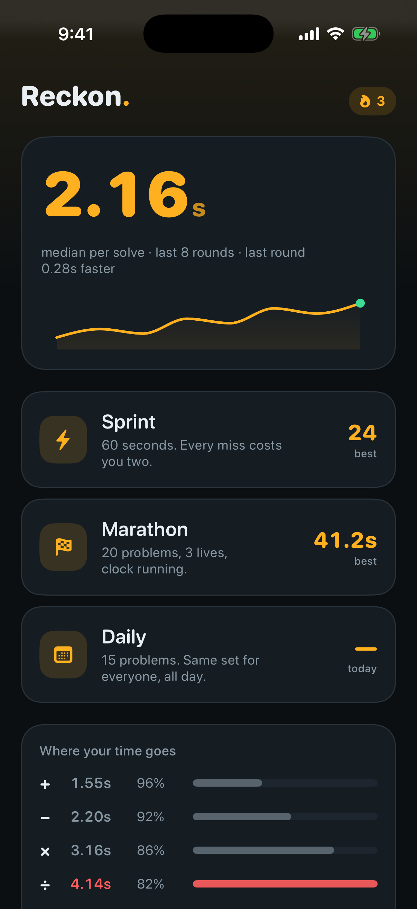

# Reckon

Mental-arithmetic drills. Timed rounds across four operations, with a median
solve time it tracks over your last 14 rounds as the headline number.

- **Sprint** — 60 seconds, each miss adds 2 seconds to the clock
- **Marathon** — 20 problems, 3 lives
- **Daily** — 15 problems, seeded from the date, identical for everyone

Everything is local. No network, no accounts, no analytics.

## Screenshots

| Light | Dark |
|---|---|
|  |  |

## Platforms

| | Path | Status |
|---|---|---|
| iOS | [`ios/`](ios/) | SwiftUI + SwiftData, iOS 17+, home-screen widget |
| Android | [`android/`](android/) | Kotlin + Jetpack Compose, in progress |

## iOS

```bash
open ios/Reckon.xcodeproj
```

Pick an iPhone simulator and hit ⌘R. Requires Xcode 16+ / iOS 17+. See
[`ios/README.md`](ios/README.md) for device installs, the widget, keyboard
handling and the module layout.

## Android

Not yet. See [`android/README.md`](android/README.md) once it exists.
